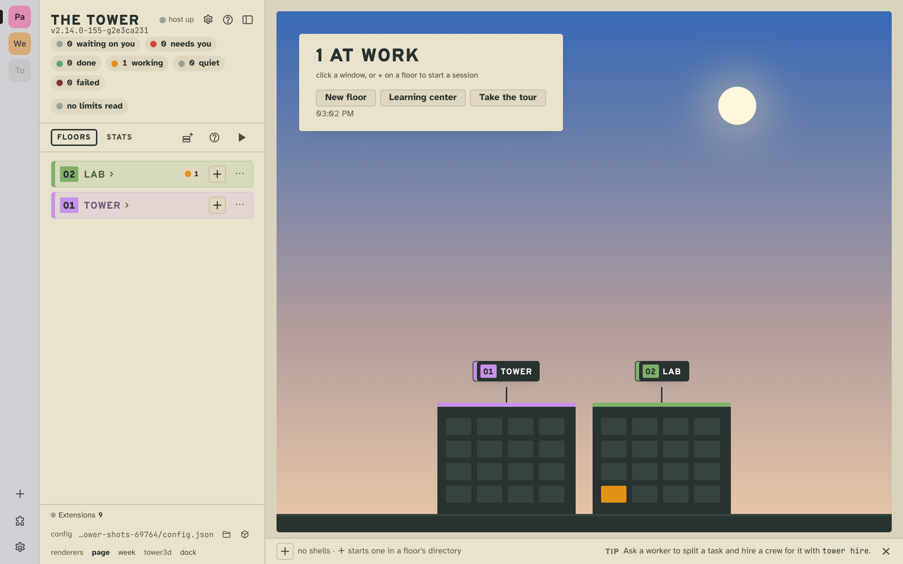
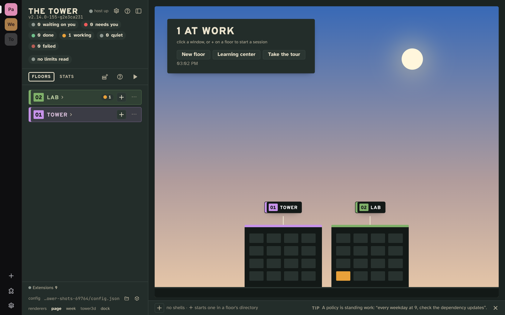
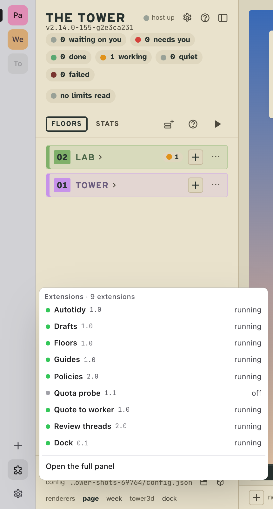
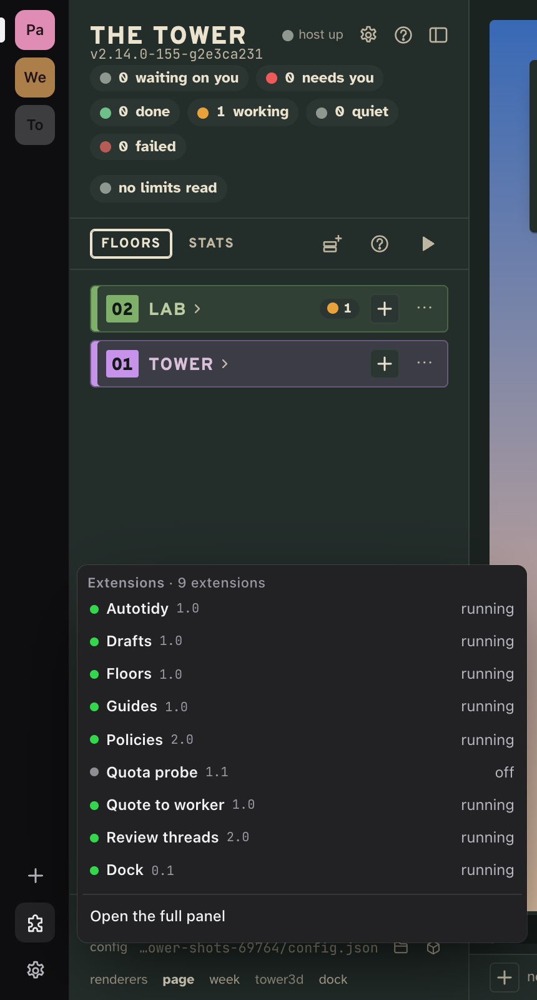

# Dock

One rail of every renderer the tower serves, beside a stage that holds them, with shelf pages pinned below.

It is an extension of [the tower](https://github.com/RegiByte/the-tower), version 2.13 or later. The tower's
[guide to extending it](https://github.com/RegiByte/the-tower/blob/main/docs/extending.md) explains the terms below.

| Light | Dark |
| --- | --- |
|  |  |

## Add it

Clone it anywhere outside the tower's checkout, at its latest release:

```sh
git clone --branch v0.1.0 https://github.com/fliptaboada/tower-extension-dock.git
```

Then add it to the tower's config (`~/.tower/config.json`) by the clone's absolute path, and make it the page `/`
opens:

```json
{
  "extensions": { "dock": { "path": "/abs/path/to/tower-extension-dock" } },
  "renderer": "dock"
}
```

It is served at `/r/dock/` either way. The tower picks it up without a restart. It has no dependencies and nothing
to build.

To update, check out a newer tag in the clone (`git fetch --tags && git checkout v<version>`), then
`tower extensions restart dock`.

## How it works

Each renderer opens in a frame of its own,
at the tower's origin as it runs opened alone. For now only the one shown runs: showing another closes its frame,
since each renderer holds its own connections to the tower and several at once exhaust what the browser allows one
origin. A renderer opens again at its own hash as you left it (the worker or view it showed); its scroll and
anything else it held in memory start afresh, and a pinned page reloads.

The frames are same-origin on purpose. A view's document frame (a markdown or text tab) inherits its renderer's
sandbox, and the view draws by reaching into it: at an opaque origin that frame is unreachable and the tab stays blank
(decision `markdown-safe`). A renderer is code the config installs and already runs at this origin at `/r/<name>/`, so
this gives it nothing it lacks there; what it gives up is the dock's isolation from a renderer, which could reach the
dock's page. Shelf pages, which the tower page frames itself, stay at an opaque origin.

It uses the Lobby renderer's tokens. The rail is its own chrome, a step deeper than any renderer's background and
edged by a hairline; the stage is flush, so each renderer draws its own window inside it.

## Use it

- Click a mark, or press ⌃1…⌃9, to show a renderer. Hovering or focusing a mark shows its name and chord at once.
  A pill on the window's edge marks the one shown.
- The **+** at the foot of the rail pins a shelf page (see [Pins](#pins)).
- The puzzle piece at the foot of the rail lists every extension with its state and problems, as the tower page's
  sidebar does (`/lib/extensions-panel.js`), and carries a dot while one isn't running. A row, or "Open the full
  panel", shows the Extensions view in the renderer that hosts views.

  | Light | Dark |
  | --- | --- |
  |  |  |

- The gear below it shows the config's path and opens it in your editor or in Finder, as the tower
  page's sidebar does (the `edit` and `reveal` verbs).
- The address is `#<renderer>`, or `#<renderer>/<its own hash>` once the dock moved it there, so a reload lands on
  the same renderer.
- A renderer moves within its own frame, as it does opened alone: the palette or a link to a worker in the tower
  page opens it there.

## Pins

Shelf entries, from any floor's shelf, pinned to the rail below the renderers, past a divider, as circles. The **+**
lists every floor's shelf; ticking an entry pins it and unticking unpins it, written to `pins` in the settings below
through the config verbs. A pin names its entry by floor and label, so reordering a shelf doesn't move it; an entry
renamed or removed leaves its pin greyed, its tooltip saying what it looked for.

How each kind opens, as the tower page's shelf view opens it:

| Kind | Opens |
|---|---|
| `html`, an item that isn't markdown, `renderer` | in a frame of the dock's at an opaque origin with the relay: the page reads the board and the API through the dock, and its moves of the tower's view (a worker, a place) land in the renderer that hosts views |
| `url` | in a frame of the dock's, as it is, told the scheme |
| `md`, a markdown item | in the shelf view of the renderer that hosts views, where markdown is drawn |
| `link` | in a tab of its own; an arrow on the pin says so |

**Changed since you last looked.** The dock follows each pinned file through the tower's version stream
(`tower.versions`): an `html` entry's page, an item's file, each file of a markdown glob as listed when the dock began
following it. When you last opened each pin is kept in `tower.store` (`dock.seen`), in your browser. A pin whose file
changed since then carries a blue dot, never a count, and its tooltip says when; opening it clears the dot. A pin first
followed counts its files as seen, so pinning marks nothing. The pinned page shown when its file changes is loaded
again in place, and a word over the stage says so. A `url`, a `link` or a `renderer` has no file to follow.

A routine that keeps a page fresh is a policy whose prompt rewrites one file in place (a repo's `html` entry, or a
kept item edited in place): a new file on each run would be a new entry, and no pin follows it.

## Settings

`extensions.dock.settings` in the config, checked by `tower config check`:

| Key | What it does |
|---|---|
| `home` | The renderer the dock opens on when its address names none. Unset: the config's `renderer` unless that is the dock, else `page`. |
| `order` | Renderers drawn first, in this order; the rest follow in the tower's order. |
| `hidden` | Renderers left off the rail. |
| `pins` | Shelf entries pinned below the renderers, in this order: `floor` (its id) and `label`, with `initials` and `color` over the ones drawn from the label. The **+** writes it. |
| `marks` | By renderer name: `initials` (one to three characters) and `color` (any CSS colour), over the ones drawn from its name; `label`, the name its tooltip shows, over the title of the extension it came from (the core's three are Tower page, The Week and Tower 3D). |

```json
{ "extensions": { "dock": { "path": "…", "settings": {
  "order": ["page", "tower3d"],
  "hidden": ["week"],
  "pins": [{ "floor": "tower", "label": "Standup" }, { "floor": "lab", "label": "Radar", "initials": "R" }],
  "marks": { "tower3d": { "initials": "3D", "color": "#7fb3c9" } }
} } } }
```

## Known edges

- A renderer in the dock doesn't know it is framed (`tower.framed` is false), so it acts as it does opened alone: a
  link to another renderer, or Tower 3D's shelf entries, open a new tab rather than showing in the dock. Pick the
  renderer on the rail instead. The fix is in the tower: a way for a same-origin frame to ask
  the page framing it to show a renderer or a place.
- A link to `/` inside a framed renderer (The Week's "← the tower") loads the tower in that frame. While the dock is
  the tower's default, the dock loaded there tells the dock framing it, which shows its home and opens that renderer
  afresh next time. With another default, that frame holds the default renderer: open the renderer again from the
  rail after hiding it, or reload.

## Pictures

From the tower's checkout, `npm run tool:extension-shots -- /abs/path/to/tower-extension-dock` retakes them from
[`shots.json`](shots.json).
